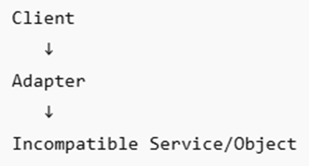

# Introduction to Adapter Design Pattern
The adapter design pattern allows two incompatible interfaces or classes to work together. To enable the interaction between two incompatible interfaces, it introduces the adaptor. The adapter converts one interface’s format into the format compatible with another interface.

It is commonly used to integrate legacy systems, third-party libraries, or incompatible APIs without modifying their original code.

Assume an application expects the processPayment() function to process the payment. Also assume that the third-party application exposed the makeTransaction() function. In this case, you can implement an adapter design pattern to convert the output of the processPayment() function into the format compatible with the makeTransaction() function and vice versa.

The adapter design pattern is used in the following scenarios:

* **Legacy System Integration** 
* **Third-Party SDK Integration** 
* **Database Driver Compatibility** 
* **Hardware/Software Connectors** 
* **API Version Migration**

## Basic Flow

Example: - **Application-->EmailAdapter--> External Mail Service** or

**Application--->paymentadapter--->Make Payment Service**
