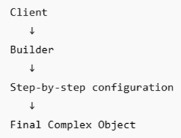

# Introduction to Builder Design Pattern
The builder design pattern constructs multiple objects with different configurations. It creates these objects with a set of consecutive steps. It separates the object’s construction process from the final representation. This separation mechanism allows the builder design pattern to create objects with different configurations.

Instead of using a constructor with multiple parameters, it uses several more readable functions and methods to create objects as follows:
* UserBuilder
  * **setName()**
  * **setEmail()**
  * **setRole()**
  * **enable2FA()**
  * **build()**

The above builder creates a user profile by executing the above set of functions. The builder design pattern is used in the following components:
* **UI Component Creation** 
* **Query Builders** 
* **Document Generation** 
* **API Request Construction** 
* **Complex Configuration Systems**

## Basic Flow

Example: - **Application---> UserBuilder---> build()---> User Object**

