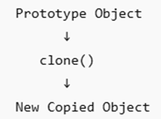

# Introduction to Prototype Design Pattern
The prototype design pattern creates a new object by cloning or copying an existing object. This design pattern is useful when creating an object is an expensive task. In real-world usage, you can use the prototype design pattern in a gaming solution where you want to create several enemy objects (characters). In the prototype design pattern, a cloning engine (a method) clones the existing object instead of initializing a new object.

## Basic Flow

Example: - **Configured Object---> clone()---> duplicate object**