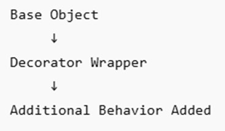

# Introduction to Decorator Design Pattern
The decorator is a structural design pattern. It dynamically adds a new behavior or functionality to an object without modifying the original parent class. After it adds a new functionality to the existing object, the existing object (base object) converts into a “decorator.” You can understand this statement as follows:

**Decorator = Base Object + New Feature**

You can use the decorator design pattern in the following scenarios:

* **SMS Notification**
* **Logging**
* **Encryption**
* **Push Notification**

## Basic Flow

You can understand this data as follows:

**Decorator = Base Object + New Feature**